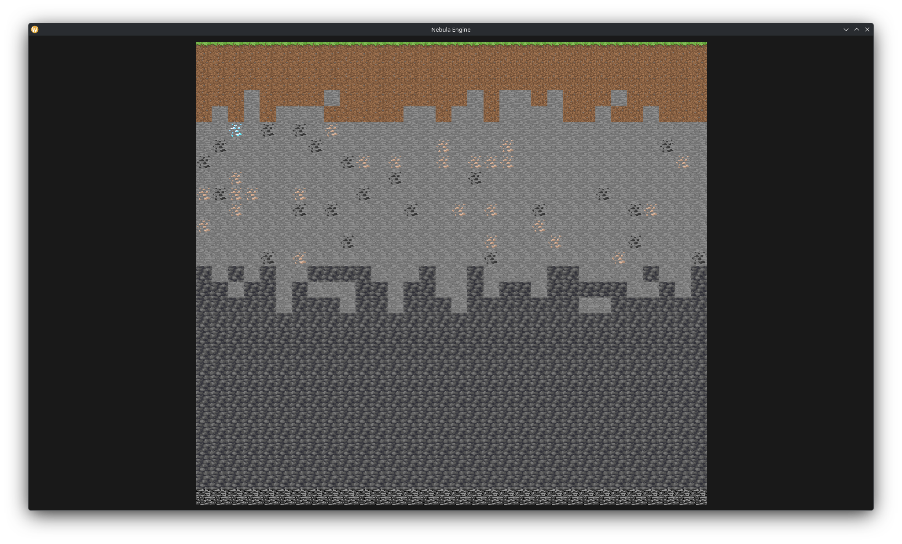

# Nebula Engine

Nebula Engine is a 2D/3D game engine used as a learning project.

## Features

Features include:
1. 2D and 3D rendering.
2. Model loading.
3. Slang shading language support.
4. ImGui for UI rendering.

Supported Platforms:
- Windows (OpenGL 4.6.0)
- macOS (Metal 3)
- Linux (OpenGL 4.6.0)

## Dependencies

Requirements for building on Windows:
- CMake 4.1.2
- Clang
- NuGet
- Windows 10.0.26100.0 SDK
- Windows App SDK 2.1.3

Requirements for building on macOS:
- CMake 4.1.2
- Clang
- XCode

Requirements for building on Linux:
- CMake 4.1.2
- Clang

## Credits

This project was started using the [TheCherno Game Engine Series](https://www.youtube.com/playlist?list=PLlrATfBNZ98dC-V-N3m0Go4deliWHPFwT).\
A huge part of the code is based on the tutorials but some parts deviated from the original code.

Libraries used:
- [Assimp](https://assimp.org/)
- [entt](https://github.com/skypjack/entt)
- [Glad2](https://github.com/Dav1dde/glad)
- [glm](https://github.com/g-truc/glm)
- [ImGui](https://github.com/ocornut/imgui)
- [ImGuizmo](https://github.com/cedricguillemet/imguizmo)
- [MacOS SDK](https://developer.apple.com/macos/) (MacOS only)
- [metal-cpp](https://github.com/apple/metal-cpp) (MacOS only)
- [NanoSVG](https://github.com/memononen/nanosvg)
- [SDL3](https://www.libsdl.org/) (Linux only)
- [Slang](https://github.com/shader-slang/slang)
- [spdlog](https://github.com/gabime/spdlog)
- [stb_image](https://github.com/nothings/stb)
- [C++/WinRT](https://github.com/microsoft/cppwinrt) (Windows only)
- [yaml-cpp](https://github.com/jbeder/yaml-cpp)
- [Windows App SDK](https://learn.microsoft.com/en-us/windows/apps/windows-app-sdk/) (Windows only)
- [Windows SDK](https://learn.microsoft.com/en-us/windows/apps/windows-sdk/) (Windows only)

## Images

Nebula Editor:

2D Rendering:

3D Rendering:

