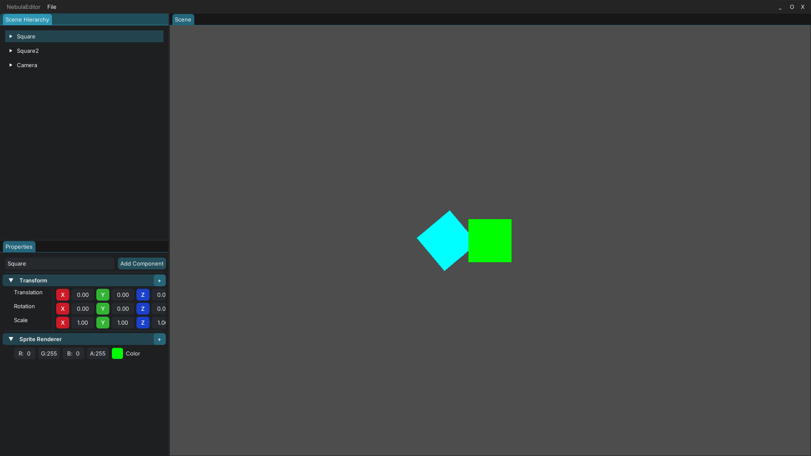
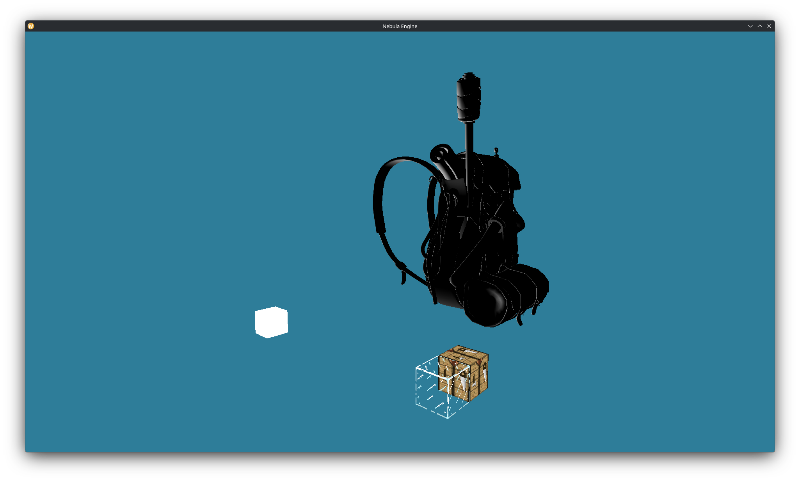

# Nebula Engine

Nebula Engine is a 2D/3D game engine used as a learning project.

## Features

Features include:
1. Windows and Linux support. (MacOS is under development using Swift interoperability)
2. OpenGL graphics API support.
3. 2D and 3D rendering.
4. Model loading.
5. ImGui for UI rendering.

## Dependencies

Requirements for building on Windows:
- CMake 4.0
- Clang-cl
- Windows 10.0.26000 SDK
- Windows App SDK 2.0-experimental3

Requirements for building on Linux:
- CMake 4.0
- Clang

## Credits

This project was started using the [TheCherno Game Engine Series](https://www.youtube.com/playlist?list=PLlrATfBNZ98dC-V-N3m0Go4deliWHPFwT).\
A huge part of the code is based on the tutorials but some parts deviated from the original code.

Libraries used:
- [Assimp](https://assimp.org/)
- [entt](https://github.com/skypjack/entt)
- [Glad2](https://github.com/Dav1dde/glad)
- [glm](https://github.com/g-truc/glm)
- [ImGui](https://github.com/ocornut/imgui)
- [SDL](https://www.libsdl.org/)
- [spdlog](https://github.com/gabime/spdlog)
- [std_image](https://github.com/nothings/stb)
- [yaml-cpp](https://github.com/jbeder/yaml-cpp)

## Images

Nebula Editor:

3D Rendering:

